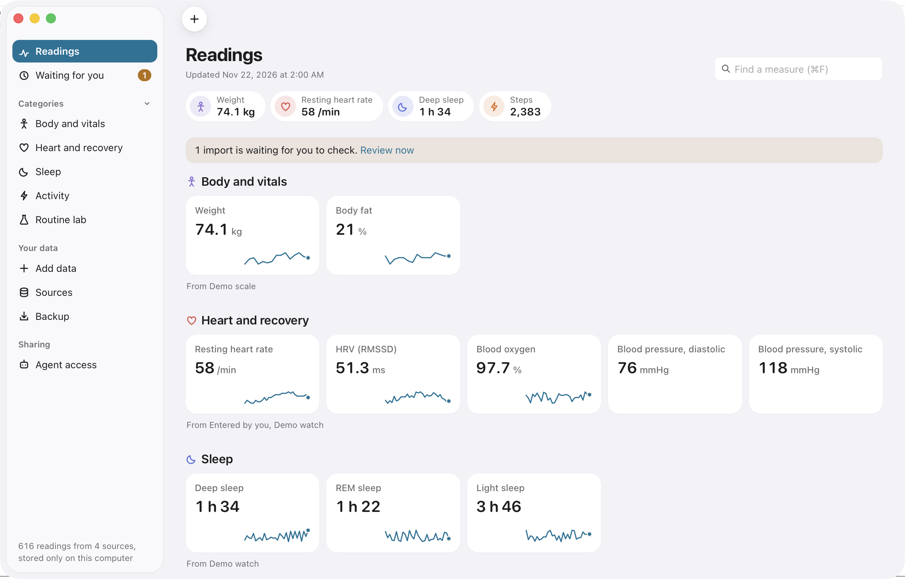
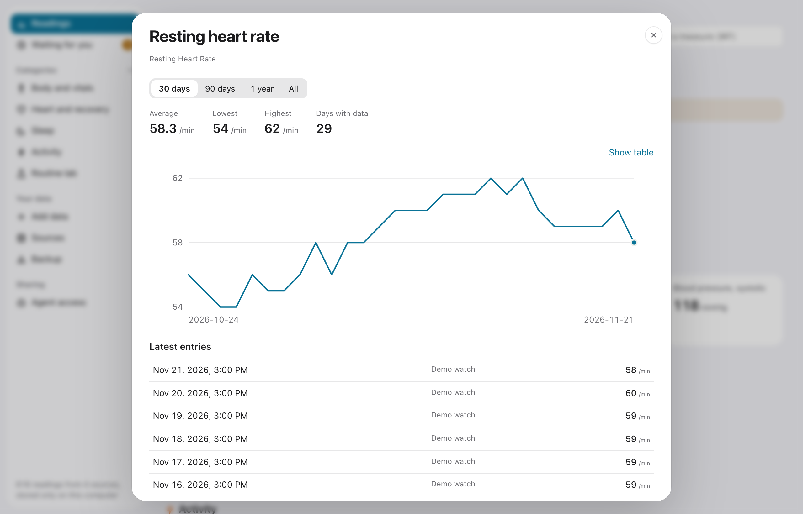
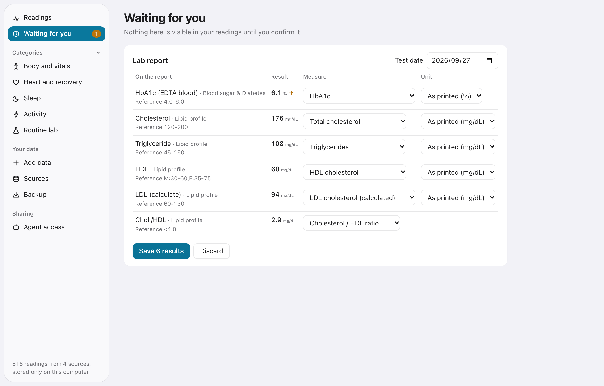
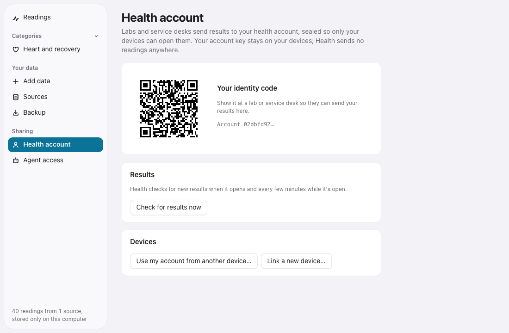

# Health

Your health data in one encrypted file on your own computer. Health brings together readings from Apple Health, WHOOP, lab reports and what you type in, shows them clearly, and lets the AI apps you choose read exactly the parts you allow.



- **Local and encrypted.** One SQLCipher database per profile; the key is in your system keychain (or behind a passphrase). Your readings are never uploaded. Health goes online only to download the optional OCR models when you ask, for your health account once you use it, and for WHOOP once you connect it. `--offline` turns both off.
- **Many sources, one view.** Apple Health exports, WHOOP data, Health backups from the web version (`.zuhealth`), photos and PDFs of lab reports, and readings you enter.
- **Results from labs.** A health account lets labs and service desks send results to you, sealed so only your devices can open them. Link this computer to the account on your phone or the web version by comparing an 8-digit check code.
- **Lab reports by photo.** Text recognition runs on your computer; each result is matched to a measure, and nothing counts until you check it.
- **Agents with limits.** Claude, Codex, Cursor, Copilot, Gemini and other MCP apps get a grant: which kinds of data, how far back, daily summaries or every reading, read only or allowed to propose. Every call is logged.
- **A desktop app and a CLI.** The app (macOS, Windows, Linux) and the `health` command share one core.

| | |
|---|---|
|  |  |
| History of one measure | A lab report, before anything is saved |

---

## Using the pre-built app

> **Status:** no release has been published yet. The workflows that produce the downloads exist (`.github/workflows/gui.yml` builds the app for macOS, Windows and Linux; `release.yml` publishes the `health` CLI for five platforms with SHA-256 sums). Until then, [build it yourself](#building-from-source).

### Install

| System | File | First launch |
|---|---|---|
| macOS (Apple silicon, Intel) | `Health_<version>_<arch>.dmg` | The app isn't signed yet: right-click Health › **Open**, then **Open** again. |
| Windows | `Health_<version>_x64-setup.exe` or `.msi` | SmartScreen may warn: **More info › Run anyway**. |
| Linux | `.AppImage`, `.deb` or `.rpm` | Make the AppImage executable, or install the package. |

On first launch Health creates your encrypted store. On macOS the keychain may ask whether Health can use its key: choose **Always Allow**.

### Get your data in

Open **Add data** (⌘2 / Ctrl+2) and choose a file, or drop it anywhere on the window:

- **Apple Health:** on iPhone, Health › your picture › *Export All Health Data*, then import the `.zip`.
- **WHOOP:** connect it under Add data › WHOOP with your own WHOOP developer app (add the redirect URL Health shows); Health then syncs every hour while it's open. A JSON file saved from the WHOOP API imports too.
- **A Health backup** (`.zuhealth`) from this app or the web version: enter its password. Importing merges; nothing is overwritten.
- **A lab report:** a photo (JPEG, PNG; on iPhone share HEIC photos as JPEG) or a PDF. The first time, Health offers to install the recognition models (about 21 MB, plus 135 MB for matching measures). The results then wait under **Waiting for you**: check each measure and unit, set the test date if it wasn't found, and save.
- **By hand:** search for a measure, or pick one of the common ones.

### Your health account

**Health account** (⌘6 / Ctrl+6):
- **Show my identity code:** creates your account on first use and shows the code a lab or service desk scans.
- **Use my account from another device:** shows a code to scan in the other device's Health app (Link a new device). Check that both show the same 8-digit code, then confirm.
- **Link a new device:** hands this computer's account to another computer; paste the code it shows.



Health checks for new results while it's open. Results with a measure or unit it doesn't know wait under **Waiting for you**. Nothing is sent before you use the account, and your readings never leave the computer: the service only relays sealed results and your account's public key.

### Connect an AI app

**Agent access** (⌘5 / Ctrl+5) › choose the app › choose what it may see › **Create access**. Health then either adds itself to the app's settings (Claude Desktop, Cursor, VS Code Copilot, Gemini CLI, Kiro), shows the command to run (Claude Code, Codex, OpenCode), or shows the settings to paste (Windsurf/Devin, Zed, Cline, Continue, LM Studio, any other MCP app). Restart the app afterwards.

Agents reach your data even when Health is closed. With a passphrase lock, keep Health open and unlocked. Apps that run in a web browser (ChatGPT, claude.ai) can't reach a program on your computer.

### Back up

**Backup** (⌘4 / Ctrl+4) saves one encrypted file with everything, including lab report photos. There is no way to recover a forgotten backup password.

### The command line

The same core is the `health` command (bundled inside the app, or the CLI download):

```sh
health status
health add loinc:29463-7 72.4 --unit kg            # weight now
health obs latest
health import apple export.zip
health component install ocr                      # once, for lab reports
health ocr report.pdf                             # then review in the app, or:
health review list
health account register                           # your identity code (contacts the health service)
health link join                                  # use your account from another device
health inbox                                      # fetch results now
health whoop connect --client-id <id>             # WHOOP sync (asks for the secret)
health grant create --name "My agent" --groups cardio,sleep --days 90
health backup export ~/health.zuhealth            # asks for a password
health --help                                     # everything else; --json for scripts
```

---

## Building from source

### Requirements

- Rust (stable, 2024 edition) and a C compiler (SQLCipher and OpenSSL are built from source the first time, which takes a while).
- For the desktop app: Node.js 24 and the [Tauri prerequisites](https://v2.tauri.app/start/prerequisites/). On Debian/Ubuntu:
  `sudo apt-get install libwebkit2gtk-4.1-dev libappindicator3-dev librsvg2-dev patchelf`

### The CLI only

```sh
cargo build --release -p health
./target/release/health init
```

Try it without touching your keychain:

```sh
export HEALTH_DATA_DIR=/tmp/h HEALTH_ROOT_KEY_FILE=/tmp/h.key
./target/release/health init && ./target/release/health status
```

### The desktop app

```sh
scripts/stage-core.sh release          # builds the core and places it next to the app
cd gui && npm ci && npx tauri build    # bundles in gui/src-tauri/target/release/bundle/
```

For development, `cd gui && npm run dev` serves the UI at http://localhost:5173 against a running `health serve` (see `docs/gui.md`).

### Lab report recognition

The models aren't in the repository or the binary. `health component install ocr` downloads them from their original locations (Hugging Face, PaddleOCR) and checks each file's size and SHA-256 before use. To install from files you already have:

```sh
health component install ocr --from ~/Downloads/ocr-models    # ppocrv5_det.onnx, ppocrv5_rec.onnx, ppocrv5_dict.txt, e5_*
```

Recognition runs in pure Rust (tract for the models, hayro for PDFs); nothing native is downloaded.

### Tests

```sh
cargo test --all                                    # core, API, CLI, serve, MCP
HEALTH_OCR_MODELS=<models dir> cargo test --all     # also OCR against the web version's output
cd gui && npx playwright test                       # the app in a browser against a real core
cargo fmt --all && cargo clippy --all-targets -- -D warnings && scripts/check-no-net.sh
scripts/demo-profile.sh /tmp/demo <models dir>      # a profile with synthetic data to try things on
```

### Where to read next

- `docs/architecture.md`: how the code is laid out, the operation table, transactions and formats.
- `docs/decisions.md`: judgment calls, and the known gaps.
- `docs/gui.md`: the desktop app's design and transport.
- `CLAUDE.md`: commands and rules for working on the code.

## License

GPL-3.0. The OCR models are Apache-2.0 (PP-OCRv5) and MIT (multilingual-e5-small); the measure catalog draws on LOINC (see `crates/health-core/data/metrics.tsv`).
